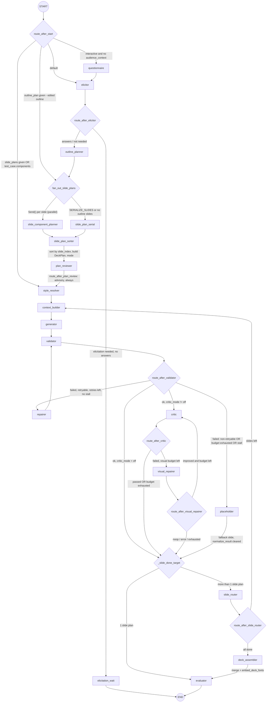
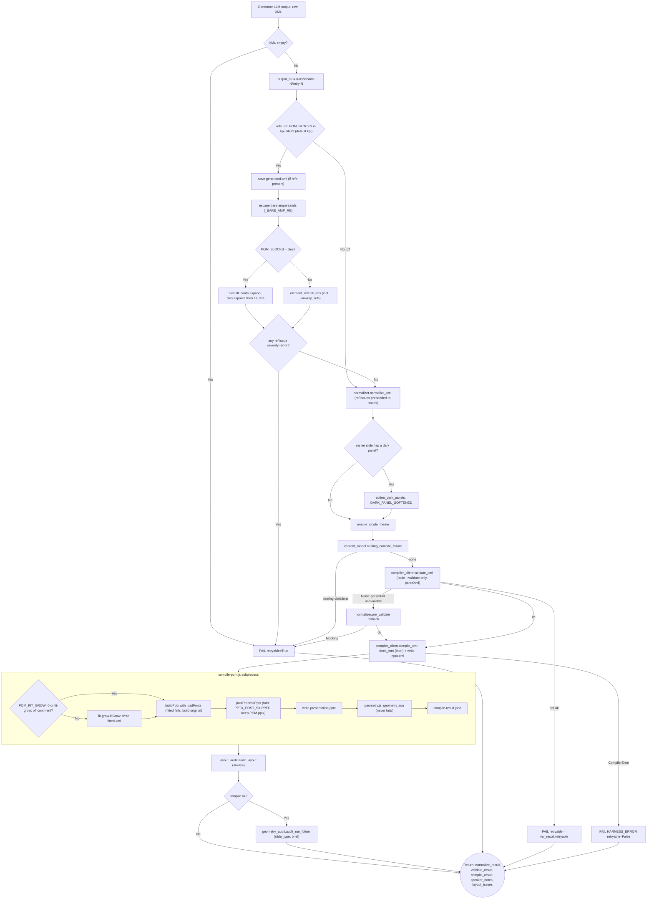

# Presentation Pipeline — Line-by-Line Code & State Flow

> Hand-traced from source on 2026-09-05. Traces **which function runs when**, **which file it lives in**, and **exactly which keys of `PresentationState` change** at each step.
>
> Entry points: `src/graph.py::run()` (CLI/library) and `src/api.py::/generate` (HTTP + SSE).
> Single state object: `PresentationState` (TypedDict) defined in [`src/state.py:81`](src/state.py).

---

## 0. The state object

`PresentationState` ([`src/state.py:81-135`](src/state.py)) is a flat `TypedDict`. Every node function receives the **whole** state and returns a **partial dict** of only the keys it owns; LangGraph merges that partial back in. Two keys use `operator.add` reducers so returns are *appended* not *replaced*:

| Key | Reducer | Written by |
|---|---|---|
| `completed_slides` | `operator.add` (list concat) | `slide_router` |
| `generation_history` | `operator.add` (list concat) | `generator`, `repairer` |

Everything else is last-write-wins.

`initial_state()` ([`src/state.py:138-186`](src/state.py)) sets every key to a zero value. Notable initial values:
`mode="single"`, `retry_tier=0`, `retry_count=0`, `retry_budget=2`, `current_slide_index=0`, `passed=False`, `current_xml=""`, all result dicts `None`, all lists `[]`.

---

## 1. Startup

### `run()` — [`src/graph.py:175-214`](src/graph.py)
1. `L188-190` import + `setup_logging()`.
2. `L192` `rid = run_id or uuid.uuid4().hex[:12]` — the run id.
3. `L193` `set_context(run_id=rid)` — binds run id to the logger.
4. `L195-205` `state = initial_state(...)` — **builds the full state** from the call args (`raw_request`, `theme_name`, `deck_min_threshold`, `critic_mode`, `supplied_content`, `test_case`, `audience_context`).
5. `L207` `app = compile_graph()` → `build_graph().compile()` ([`src/graph.py:131-170`](src/graph.py)).
6. `L213` `final = app.invoke(state, config=config)` — runs the graph to completion, returns final state.

### API path — [`src/api.py:212-284`](src/api.py)
- `/generate` (`L212`): make `run_id` (`L215`), register `_runs[run_id] = RunRecord(status="running")` (`L216`).
- `_run_pipeline_sync()` (`L183-203`): builds `initial_state()`, then `graph.stream(state)` — yields `(node_name, state_update)` **per node** instead of one final blob.
- `event_stream()` (`L218-278`): a background thread (`_producer`, `L224`) drains the graph into a `queue`; the async side pulls items, calls `_merge_state(accumulated, state_update)` (`L253` → `L173-178`) to keep a running copy, `_build_event()` (`L260` → `L141-170`) to turn the node name into an SSE event (`planning`/`styling`/`generating_slide`/`validating`/`repairing`/`reviewing`/`assembling`/`complete`), and `_estimate_progress()` (`L258` → `L130-136`) for the % bar.

---

## 2. Graph topology — [`src/graph.py:298-376`](src/graph.py)

> Checked against the source on 2026-10-21 (commit `58c93b6`). Routing functions: [`src/graph.py:74-238`](src/graph.py). Sections 3 and 4 below were re-traced on the same date; sections 5–7 are still the 2026-09-05 trace.



---

## 3. Routing functions (no state writes — read only)

> Traced from the source on 2026-10-21 (commit `e04963c`). All in [`src/graph.py`](src/graph.py).

### `route_after_start` — [`src/graph.py:74-100`](src/graph.py:74)
Returns a node name or a list of `Send` (via `fan_out_slide_plans`).
- `L77-79` `slide_plans` already in state → **`"style_resolver"`** (all planning skipped).
- `L81-84` `test_case["components"]` present → **`"style_resolver"`** (`context_builder._build_default_plan` builds the plan later).
- `L89-92` `outline_plan["slides"]` present (a user-edited outline, `PUT /plan/{run_id}/outline`) → **`fan_out_slide_plans(state)`**: elicitor and outline planner skipped, so the edited outline is kept.
- `L95-97` `interactive` and no `audience_context` → **`"questionnaire"`**.
- `L99-100` else → **`"elicitor"`**.

### `route_after_elicitor` — [`src/graph.py:103-108`](src/graph.py:103)
- `elicitation_needed` and no `elicitation_answers` → **`"elicitation_wait"`** (→ END; the API resumes the run once the user answers).
- else → **`"outline_planner"`**.

### `fan_out_slide_plans` — [`src/graph.py:111-129`](src/graph.py:111)
- `SERIALIZE_SLIDES` (env, `slide_component_planner.py`) → **`"slide_plan_serial"`**.
- `outline_plan["slides"]` empty → **`"slide_plan_serial"`** (logged as a warning).
- else → one **`Send("slide_component_planner", {**state, "current_outline_slide": slide})`** per outline slide (parallel; fan-in through the `assembled_slide_plans` reducer).

### `route_after_plan_review` — [`src/graph.py:158-164`](src/graph.py:158)
Logs `plan_review.confidence_score` / `approved`, always **`"style_resolver"`**: the review is advisory (the feedback loop in `docs/plan-reviewer-loop.md` is not built).

### `_slide_done_target` — [`src/graph.py:167-171`](src/graph.py:167)
`len(slide_plans) > 1` → **`"slide_router"`**, else **`"evaluator"`**. Every "slide finished" exit below goes through it.

### `route_after_validator` — [`src/graph.py:174-196`](src/graph.py:174)
Reads `compile_result`, `retry_budget` (default 3), `retry_count`, `stall_detected`, `critic_mode`.
- compile failed, `retryable`, `retry_count < retry_budget` and not `stall_detected` → **`"repairer"`**.
- compile failed otherwise (budget used up, stall, or not retryable such as `HARNESS_ERROR`) → **`"placeholder"`**.
- compile ok, `critic_mode == "off"` → `_slide_done_target()`.
- compile ok, any other `critic_mode` → **`"critic"`**.

### `route_after_critic` — [`src/graph.py:199-212`](src/graph.py:199)
Reads `critic_result`, `visual_repair_budget`, `visual_repair_count`.
- not passed and `visual_repair_count < visual_repair_budget` → **`"visual_repairer"`**.
- not passed, budget used up → `_slide_done_target()`.
- passed → `_slide_done_target()`.

### `route_after_visual_repairer` — [`src/graph.py:215-224`](src/graph.py:215)
- `visual_repair_outcome == "improved"` and `visual_repair_count < visual_repair_budget` → **`"critic"`** (re-review).
- else (`noop`, `error`, or budget used up) → `_slide_done_target()`.

### `route_after_repairer` — [`src/graph.py:237-238`](src/graph.py:237)
Always **`"validator"`**: the repairer already produced XML, so it is validated directly, without the generator.

### `placeholder` exit — [`src/graph.py:365-368`](src/graph.py:365)
A lambda: `_slide_done_target(state)`.

### `route_after_slide_router` — [`src/graph.py:227-234`](src/graph.py:227)
- `current_slide_index < len(slide_plans)` → **`"context_builder"`** (next slide).
- else → **`"deck_assembler"`**.

---

## 4. Node-by-node execution & state mutations

> Traced from the source on 2026-10-21 (commit `e04963c`). Keys marked **append** use an `operator.add` reducer in [`src/state.py`](src/state.py): `assembled_slide_plans`, `completed_slides`, `generation_history`, `slide_critic_results`. Most LLM nodes append a usage record (`usage_record(...)` or `AttemptRecord`) to `generation_history`; the evaluator sums them for tokens and cost.

### 4.1 `questionnaire_node` — [`src/agents/questionnaire.py:99-150`](src/agents/questionnaire.py:99) — **no LLM**
**Runs only when** `interactive=True` and `audience_context` is empty (else returns `{}`).
- Asks audience and data density, then the theme (names from `palettes.yaml`), then slide count and focus, on the CLI.
- `_slide_count_to_threshold(slide_count)` → `deck_min_threshold`.

| key | value |
|---|---|
| `audience_context` | answers dict |
| `theme_name` | chosen palette |
| `deck_min_threshold` | from the slide-count answer |

### 4.2 `elicitor_node` — [`src/agents/elicitor.py:93-134`](src/agents/elicitor.py:93)
- `elicitation_answers` already present → `{"elicitation_needed": False}` (no LLM call).
- else `check_and_elicit(raw_request, additional_instructions, deck_settings, supplied_content)`: an LLM judges whether the brief is enough.
- An LLM error is swallowed: `elicitation_needed=False` (the run carries on without questions).

| key | value |
|---|---|
| `elicitation_needed` | `not result.is_sufficient` |
| `elicitation_questions` | `[]`, or the questions as dicts |
| `generation_history` | **append** usage record `elicitor` |

### 4.3 `elicitation_wait` — [`src/graph.py:243-250`](src/graph.py:243)
No-op (`{}`) → END. It makes the suspend point explicit; the API resumes the run after the user answers.

### 4.4 `outline_planner_node` — [`src/agents/outline_planner.py:86-150`](src/agents/outline_planner.py:86)
- `_get_constraints(deck_settings)` → narrative / text mode / provenance rules for the prompt.
- Slide count: the test case's `slide_count`, else the count the request states (`stated_slide_count`), else `deck_min_threshold` from the settings.
- One structured LLM call (`OutlinePlannerOutput`, `json_schema`; model from `models.yaml` step `outline_planner`).
- `clean_data(outline)` strips XML-illegal control characters.
- `brief_instructions(raw_request)` → `outline["brief_instructions"]` (the plan checks read them); `settle_direction_lines` moves presenter notes / visual directions off each slide's content.

| key | value |
|---|---|
| `outline_plan` | `{deck_title, core_hook, slides: [...], brief_instructions}` |
| `generation_history` | **append** usage record `outline_planner` |

### 4.5 `slide_component_planner_node` — [`src/agents/slide_component_planner.py:423-453`](src/agents/slide_component_planner.py:423)
Runs once per outline slide (the `Send` payload carries `current_outline_slide`). No slide → `{"assembled_slide_plans": []}`.
- `plan_with_reask(slide, ...)` (`L324-391`): up to two `plan_single_slide` calls.
  - `find_problems(plan, brief_text, instructions)` scores each plan (empty plan, instruction text, etc.); the second call gets `reask_context(problems)`. The plan with fewer problems wins (a tie keeps the first).
  - Both calls failed, or the winner holds no content → `fallback_plan(slide)`: the slide's own brief lines as one `bullet_list`, `plan_source="fallback"`.
  - `finalize_plan` runs the code fixes (capacity, written-line checks, ...). Its notes and the re-ask reason go to `plan["capacity_fixes"]`.

| key | value |
|---|---|
| `assembled_slide_plans` | **append** `[plan]` |
| `generation_history` | **append** one record per planner call (`reask` / `failed="length"` marked) |

### 4.6 `slide_plan_serial_node` — [`src/agents/slide_component_planner.py:396-418`](src/agents/slide_component_planner.py:396)
Same as 4.5 but loops over every outline slide in one node (`SERIALIZE_SLIDES`, or an empty outline). Writes the same two keys, with all plans at once.

### 4.7 `slide_plan_sorter_node` — [`src/graph.py:132-155`](src/graph.py:132) — **no LLM**
Sorts `assembled_slide_plans` by `slide_index`.

| key | value |
|---|---|
| `slide_plans` | the sorted plans |
| `core_hook` | `outline_plan.core_hook` |
| `deck_plan` | `DeckPlan(core_hook, slide_count, theme, slides)` |
| `mode` | `"deck"` if more than 1 plan, else `"single"` |

### 4.8 `plan_reviewer_node` — [`src/agents/plan_reviewer.py:38-107`](src/agents/plan_reviewer.py:38)
- No `slide_plans`, or the LLM call fails → neutral review (`confidence_score=0.5`, `approved=True`, no issues).
- else one structured LLM call (`PlanReviewerOutput`); high-severity issues are logged as warnings. Nothing acts on the review yet (see `route_after_plan_review`).

| key | value |
|---|---|
| `plan_review` | `{confidence_score, approved, summary, issues}` |
| `generation_history` | **append** usage record `plan_reviewer` (not on the neutral path) |

### 4.9 `style_resolver_node` — [`src/agents/style_resolver.py:102-110`](src/agents/style_resolver.py:102) — **no LLM**
`resolve_theme(theme_name)` from `theme/palettes.yaml`; an unknown or empty name gives the default palette.

| key | value |
|---|---|
| `theme_element` | `<Theme ... />` string with the palette tokens |
| `resolved_theme` | `{name, mode, is_dark, chart_colors, chart_colors_json, chart_focus, element}` |

### 4.10 `context_builder_node` — [`src/agents/context_builder.py:716-736`](src/agents/context_builder.py:716) — **no LLM**
Runs once per slide.
- No `slide_plans` (test-case path) → `_build_default_plan(state)` (`L685-713`): kinds from `test_case.components`, else intent detection on the request, else title / narrative / bullet list.
- `plan = slide_plans[current_slide_index]`; theme from `resolved_theme` (or `resolve_theme`).
- `build_contract(plan, theme)` (`L558-682`): allowed nodes / attributes and hierarchy from `nodes.yaml`, forbidden tags / attributes, notes, house style, component recipes, visual-intent techniques, hint scopes, icon names. Golden examples and blueprint reference XML only with `POM_EXAMPLES=on`. Under `POM_BLOCKS=tiles`, the recipes and techniques for KPI rows and card grids that code draws are left out.

| key | value |
|---|---|
| `contract` | the dict above |

### 4.11 `generator_node` — [`src/agents/generator.py:95-147`](src/agents/generator.py:95)
- `_render_prompts` (`L30-93`): `prompts/generator/system.j2` + `user.j2` from the contract and the slide plan. With refs on (`POM_BLOCKS=kpi|tiles`), a `kpi_row`'s values are removed from the prompt and replaced by a ref line (`element_refs.prompt_line` / `tiles.prompt_line`); under `tiles` the same happens for card grids code draws, and the tile / card node lines go in the system prompt.
- One LLM call (step `generator`); `finish_reason == "length"` marks the record `truncated`.
- An LLM error → `{"current_xml": ""}` (the validator then fails it as empty, retryable).

| key | value |
|---|---|
| `current_xml` | the LLM's raw XML |
| `generation_history` | **append** `AttemptRecord(step="generator", ...)` |

### 4.12 `validator_node` — [`src/agents/validator.py:35-204`](src/agents/validator.py:35) — **no LLM**



Notes on the diagram:
- Output folder: `output/runs/{run_id}/`, plus `slide-{idx}/` in a deck and `retry-{n}/` when `retry_count > 0`.
- Ref fill issues that are not errors are kept and put in front of the normalizer's issues (`auto_fixed=True`).
- `validate_xml` returns `None` when Node / the compiler is not available; the regex `pre_validate` then stands in.
- `compile_xml` (`compiler_client.py:68`) marks a result `retryable` from its diagnostic types; a `CompilerError` (harness broken) is `retryable=False`, so the slide goes to `placeholder` instead of looping.

| key | value |
|---|---|
| `normalize_result` | `{cleaned_xml, issues, auto_fixed, blocking, speaker_notes}` |
| `validate_result` | `{ok, diagnostics, warnings}` |
| `compile_result` | `{ok, pptx_path, diagnostics, warnings, retryable}` |
| `speaker_notes` | extracted `<Notes>` text (success path only) |
| `layout_issues` | layout audit + geometry audit findings (`[]` on early failures) |

### 4.13 `repairer_node` — [`src/agents/repairer.py:361-633`](src/agents/repairer.py:361)
Reached from `route_after_validator` only (compile failed, retryable, budget left, no stall).
- `_collect_problems` (`L81`): normalize issues not auto-fixed + compile diagnostics + visual issues as lines.
- `error_signatures(...)` vs the last record's `error_sigs` → `is_stalled` (from the second attempt on).
- `_choose_strategy` (`L261-298`): attempt 1 = **PATCH**; the attempt after a REGENERATE = PATCH (cleanup); a previous no-op / truncated PATCH, a structural error (`needs_regeneration`) or a stall = **REGENERATE**; from attempt 2 a slide that still doesn't compile = REGENERATE.
- **PATCH**: `build_patch_prompts` with the normalizer's cleaned XML + problems → `_call_llm_and_return` (`L301`, step `repairer`). A PATCH that returns the same XML is marked `noop`.
- **REGENERATE**: `plan_single_slide(outline slide, repair_context=...)` re-plans the slide (from the outline's own slide when there is one), `build_contract`, then the generator prompts and one `generator` LLM call. If re-planning or generating fails it falls back to PATCH. A truncated result keeps the old XML / plan / contract.
- An unhandled error burns the attempt: `retry_count + 1`, `stall_detected=True` (→ placeholder next).

| key | value |
|---|---|
| `current_xml` | repaired XML (not on a truncated REGENERATE) |
| `retry_tier` | `1` PATCH / `2` REGENERATE |
| `retry_count` | `+1` |
| `stall_detected` | stall result |
| `slide_plans`, `contract` | REGENERATE only: the re-planned slide and its contract |
| `generation_history` | **append** `AttemptRecord(step="repairer")`; REGENERATE also a `slide_component_planner` record |

### 4.14 `critic_node` — [`src/agents/critic.py:122-218`](src/agents/critic.py:122)
Runs when `critic_mode != "off"` after a successful compile, and again after an improved visual repair.
- `_run_visual_review` (`L67-119`): renders the slide's pptx (`render_screenshots`, LibreOffice) to `screenshots/slide-{idx}/` (`re-review-{n}/` on later rounds), then `run_visual_critic` with the screenshot, the fitted XML (`fitted.xml`, what was drawn), the plan, compile warnings and `critic_layout_issues(layout_issues)`. No pptx or no screenshot → no issues (pass).
- `passed` = no high and no medium issues; `compute_critic_score(issues, assessment)`.
- First review: saves the pre-repair XML / plans / contract / score.
- Re-review that still fails with a score no better than before → **rolls back** to the pre-repair XML, plans and contract, and marks the slide passed.
- Any unhandled error fails open (`passed=True`).

| key | value |
|---|---|
| `critic_result` | `{passed, issues}` |
| `visual_critic_result` | `{passed, issues, screenshot_path, repair_hints}` |
| `pre_critic_xml`, `pre_critic_slide_plans`, `pre_critic_contract`, `pre_critic_score` | first review only |
| `current_xml`, `slide_plans`, `contract` | rollback only |
| `slide_screenshots` | `{idx: png}` merged in |
| `generation_history` | **append** usage record `critic` (when the LLM ran) |

### 4.15 `visual_repairer_node` — [`src/agents/visual_repairer.py:130-205`](src/agents/visual_repairer.py:130)
- Strategy from `visual_critic_result.repair_hints.strategy`: `"regenerate"` → `_do_regenerate` (`L74`: re-plan with `plan_single_slide`, new contract, one `generator` call); anything else → `_do_patch` (`L56`: one `repairer` call with the visual issues).
- Then `normalize_and_compile` into `output/runs/{run_id}/visual-repair-{n}/`.
- Outcome: call failed, truncated, or the new XML doesn't compile → `"error"` (old XML kept); a PATCH returning the same XML → `"noop"`; compiles → `"improved"`.

| key | value |
|---|---|
| `visual_repair_count` | `+1` (every outcome) |
| `visual_repair_outcome` | `improved` / `noop` / `error` |
| `current_xml`, `compile_result` | `improved` only |
| `slide_plans`, `contract` | `improved` REGENERATE only |
| `generation_history` | **append** `AttemptRecord(step="visual_repairer")` (+ planner record on REGENERATE) |

### 4.16 `placeholder_node` — [`src/graph.py:253-295`](src/graph.py:253) — **no LLM**
When repair is exhausted / stalled / not retryable: a minimal slide (the plan's title + "Slide could not be generated.") compiled into `placeholder-{idx}/`. If even that fails, a synthetic ok result.

| key | value |
|---|---|
| `current_xml` | the placeholder XML |
| `compile_result` | its result, `warnings` + `"placeholder"` |
| `normalize_result` | `None` (so `slide_router` saves the placeholder, not the failed slide) |

### 4.17 `slide_router_node` — [`src/agents/deck_nodes.py:61-105`](src/agents/deck_nodes.py:61) — **no LLM**
Saves the slide that just finished and resets the per-slide keys. The saved XML is `normalize_result.cleaned_xml` (what the validator compiled) or `current_xml`.

| key | value |
|---|---|
| `completed_slides` | **append** `{slide_index, xml, speaker_notes, compile_ok, pptx_path}` |
| `slide_critic_results` | **append** `critic_result` (or `{"passed": True}`) |
| `current_slide_index` | `+1` |
| per-slide keys reset | `current_xml`, `speaker_notes`, `normalize_result`, `validate_result`, `compile_result`, `critic_result`, `visual_critic_result`, `visual_repair_count`, `visual_repair_outcome`, `pre_critic_*`, `layout_issues`, `retry_tier`, `retry_count`, `stall_detected` |

### 4.18 `deck_assembler_node` — [`src/agents/deck_nodes.py:155-246`](src/agents/deck_nodes.py:155) — **no LLM**
- Sorts `completed_slides`; slides with `compile_ok=False` are excluded.
- `assemble_deck_xml` (`L31-58`): each `<Slide>` block without its theme, one `<Theme>`, then `normalize_xml` + `ensure_single_theme` again.
- `compile_xml(combined, output/runs/{run_id}/deck/)`; if the combined compile fails → `_zip_merge_fallback` merges the per-slide pptx files (`ZIP_MERGE` warning).
- On success, `embed_deck_fonts(pptx)` subset-embeds the deck fonts; skipped fonts become warnings.
- No slides, all slides failed, or no `<Slide>` block → a failed `compile_result` (`retryable=False`).

| key | value |
|---|---|
| `current_xml` | the combined deck XML |
| `compile_result` | deck compile (or ZIP merge) result |
| `pptx_path` | the deck file |
| `excluded_slides` | indexes of the slides left out |

### 4.19 `evaluator_node` — [`src/agents/evaluator.py:195-319`](src/agents/evaluator.py:195) — **no LLM**, terminal node
- One-slide run: `embed_deck_fonts` on the slide's own pptx (decks were embedded by `deck_assembler`).
- Critic verdict: deck → all `slide_critic_results`; single slide → `critic_result`.
- `passed = compile_ok and critic_ok and no excluded slides`.
- Tokens (in / out / reasoning / cached) and cost (`_compute_cost`, cached input at the model's `cached_input` rate) summed over `generation_history`; `_build_step_summary` per step.
- Writes `output/runs/{run_id}/run-manifest.json` (with `_run_provenance`: commit, dirty flag, theme, request hash), final screenshots if the critic took none, and the per-slide edit data (`_write_slides_data`).

| key | value |
|---|---|
| `evaluation` | the manifest dict |
| `pptx_path` | final pptx |
| `passed` | bool |
| `slide_screenshots` | when screenshots were made |

---

## 5. Two canonical end-to-end traces

### 5.1 Single slide, clean compile, critic passes
```
initial_state                  → mode=single, retry_count=0, current_xml=""
route_after_start              → planner            (interactive=False, no components)
planner_node          [LLM]    → mode, core_hook, deck_plan=None, slide_plans=[1]
style_resolver_node            → theme_element, resolved_theme
context_builder_node           → contract
generator_node        [LLM]    → current_xml=<xml>, generation_history=[a0]
validator_node        [node]   → normalize_result, validate_result, compile_result{ok:True,pptx_path}, speaker_notes, layout_issues
route_after_validator          → critic             (ok, critic_mode=auto)
critic_node           [LLM]    → critic_result{passed:True}, visual_critic_result
route_after_critic             → evaluator          (len(slide_plans)==1)
evaluator_node        [node]   → evaluation, pptx_path, passed=True
END
```

### 5.2 Single slide, compile fails twice then succeeds
```
generator_node        [LLM]    → current_xml=v1, generation_history=[a0(tier0)]
validator_node                 → compile_result{ok:False, retryable:True}
route_after_validator          → repairer           (retry_count 0 < 3)
repairer_node         [LLM]    → current_xml=v2, retry_tier=1, retry_count=1, generation_history+=[a1(PATCH)]
route_after_repairer           → validator
validator_node                 → compile_result{ok:False, retryable:True}   (same errors)
route_after_validator          → repairer           (retry_count 1 < 4)
repairer_node         [LLM]    → is_stalled → retry_tier=2 (REGENERATE), retry_count=2, current_xml=v3, generation_history+=[a2]
route_after_repairer           → validator
validator_node                 → compile_result{ok:True, pptx_path}
route_after_validator          → critic → ... → evaluator
evaluator_node                 → passed = compile_ok and critic_ok
```
Budget exhaustion: once `retry_count == retry_budget (2)`, `route_after_validator`/`route_after_critic` fall through to `evaluator` (single) or `slide_router` (deck) with the last (failing) `compile_result`, so `evaluator` sets `passed=False`.

### 5.3 Deck (planner returns > 1 slide — driven by `deck_min_threshold` target or an explicit multi-slide request)
```
planner_node                   → mode=deck, slide_plans=[N], deck_plan=DeckPlan
style_resolver_node            → resolved_theme            (once)
┌── per slide i = 0..N-1 ──────────────────────────────────
│ context_builder_node         → contract                  (for slide i)
│ generator_node       [LLM]   → current_xml, generation_history+=[...]
│ validator_node               → *_result                  (+ repairer loop as needed)
│ critic_node          [LLM]   → critic_result
│ route_after_critic           → slide_router              (len>1)
│ slide_router_node            → completed_slides+=[slide i], current_slide_index=i+1, RESET per-slide keys
│ route_after_slide_router     → context_builder (i<N)  |  deck_assembler (i==N)
└──────────────────────────────────────────────────────────
deck_assembler_node   [node]   → current_xml=combined, compile_result (final), pptx_path
evaluator_node                 → evaluation, passed
END
```

---

## 6. Where each state key is written (index)

| Key | Written by (file:node) |
|---|---|
| `run_id`, `mode`, `raw_request`, `theme_name`, `test_case`, `supplied_content`, `deck_min_threshold`, `interactive`, `retry_budget` | `state.py::initial_state` |
| `audience_context`, `theme_name`, `deck_min_threshold` | `questionnaire.py::questionnaire_node` |
| `mode`, `core_hook`, `deck_plan`, `slide_plans` | `planner.py::planner_node` |
| `theme_element`, `resolved_theme` | `style_resolver.py::style_resolver_node` |
| `contract` | `context_builder.py::context_builder_node` |
| `current_xml`, `generation_history` | `generator.py::generator_node`, `repairer.py::repairer_node` |
| `normalize_result`, `validate_result`, `compile_result`, `speaker_notes`, `layout_issues` | `validator.py::validator_node` |
| `retry_tier`, `retry_count`, `stall_detected` | `repairer.py::repairer_node` (reset by `slide_router`) |
| `critic_result` | `critic.py::critic_node` |
| `completed_slides`, `current_slide_index` | `deck_nodes.py::slide_router_node` |
| `current_xml`, `compile_result`, `pptx_path` | `deck_nodes.py::deck_assembler_node` |
| `evaluation`, `pptx_path`, `passed` | `evaluator.py::evaluator_node` |

---

## 7. External calls summary

| Node | LLM? | Subprocess? | models.yaml step |
|---|---|---|---|
| questionnaire | no | no | – |
| planner | **yes** (structured `PlannerOutput`) | no | `planner` |
| style_resolver | no | no | – |
| context_builder | no | no | – |
| generator | **yes** (free text) | no | `generator` |
| validator | no | **yes** — `node compile-pom.js` (validate + compile) | – |
| repairer | **yes** (free text) | no | `repairer` |
| critic | **yes** (vision LLM, `VisualCriticOutput`) | no | `visual_critic` |
| slide_router | no | no | – |
| deck_assembler | no | **yes** — `node compile-pom.js` (final) | – |
| evaluator | no | no | – |

LLM construction: [`src/utils/llm_client.py:40-69`](src/utils/llm_client.py) `get_llm(step)` — merges `models.yaml` `defaults` + `steps.<step>`, provider `openai` or `azure_openai`.
Compiler bridge: [`src/compiler/compiler_client.py`](src/compiler/compiler_client.py) — always reads `compile-result.json`, never parses stderr.
