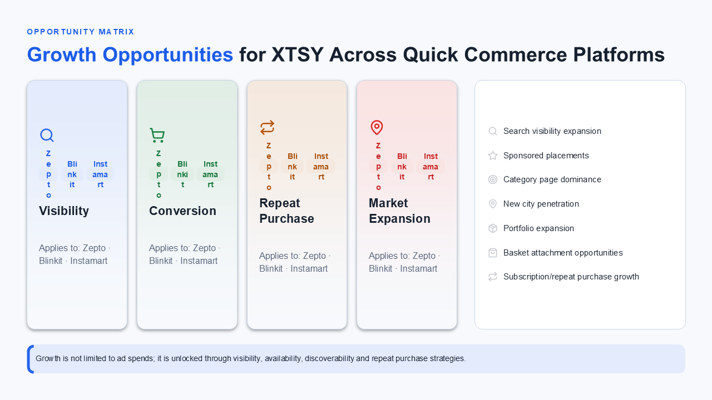
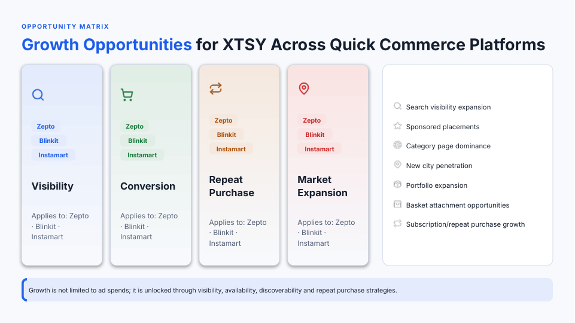

# Deck output fixes (2026-10-15)

Fixes for the problems the full-deck eval of 2026-10-15 found (`choice-decks`, commit `4d07142`, agency + XTSY,
14 slides, $0.585; bundle `output/eval/choice-decks-20261015-212457/`). One step per problem, each measured
before and after on saved runs, LLM-free. Renders: `docs/eval/deck-output-fixes/`.

| step | problem | built | measured on |
|---|---|---|---|
| 1 | brief instructions printed when the outline rewords their label | outline + plan checks read the brief's own instruction lines | 782 saved plans with a known case |
| 2 | a free-drawn layer beside cards that already show its content | plan check `LAYER_REPEATED` + one planner prompt line | 40 saved layers |
| 3 | platform tags broken letter by letter; one line repeated on every card | fit-grow `wrapChipRows`; plan fix `drop_shared_card_lines` | 345 saved card-grid plans; the eval's 14 slides replayed |
| 4 | agency slide 2: compile timed out, placeholder reported, full slide in the deck | one font registry, time budget inside a slide, result kept when Node does not exit, placeholder saved | the eval's 14 slides replayed |
| 5 | free-drawn diagrams (layer, flow) small / empty / broken words | planner prompt: flow direction and step count (built); the rest is a plan (below) | 36 saved flow plans, 29 saved slides with a `<Flow>` or `<Layer>` |

Unit tests: baseline 1139 pass + the 4 known failures; after: see "Checks" at the end.

## Step 1 — brief instructions without their label

**Cause.** The checks caught only labelled lines (`Speaker Notes:`, `Visual:`, `Show:`). The agency brief's
"Speaker Notes: End with confidence. …" came back from the outline as "Note: End with confidence. …"; XTSY's
"Use arrow visuals rather than hard numbers." has no label in the brief at all. Both were planned as captions.

**Built.**
- `written_lines.brief_instructions(request)`: the brief's lines that are not slide content — `notes` (text after a
  speaker-notes label) and `directions` (unlabelled sentences that start with a build verb and name a design element:
  use / avoid / show / keep … + visual / colour / layout / chart …). Labelled directions stay with `visual_directions`.
  On all 56 case briefs it finds only real instructions (e.g. "Keep the two columns visually balanced.", "Use a deep-to-light
  blue gradient …"); a data note ("Note: SOC2 + HIPAA certification targeted for Apr 2027.") is not one.
- Outline (`outline_planner`): `settle_direction_lines(slide, instructions, content)` drops a key message that rewords
  the brief's notes and turns one that rewords a direction into a `Visual:` line (so the planner still reads it as
  design input and the existing code keeps it off the slide). A message whose words are also in the rest of the brief
  stays. The instructions are stored in `outline_plan["brief_instructions"]`.
- Plan checks: `is_instruction_text(text, brief_text, instructions)` — text that words a brief instruction (any short
  label in front taken off, 3+ content words, 70% of its words in one instruction line) is instruction text unless the
  slide's other brief lines say it too. Used by `find_problems` (re-ask) and `finalize_plan` (drop); the planner passes
  `instruction_lines(outline_plan)`. Without the outline's lines (old outlines, plan editor) nothing changes.

**Before / after** (782 saved plans with a known case; text items of narrative / caption / bullet_list):

| | before | after |
|---|---|---|
| items flagged as instruction text | 26 | 34 |
| newly flagged | — | 8: agency 6 "Note: End with confidence …" (1), agency 6 "The audit already shows …" (1), XTSY 7 "Use arrow visuals rather than hard numbers." (6, one with "Note:") |
| real content newly flagged | — | 0 |
| saved outlines (runs.json) whose key messages change | — | 4: XTSY 7 "Use arrow visuals …" → `Visual:` line |

Tests: `tests/unit/test_deck_output_fixes.py` (step 1 section, 5 tests).

## Step 2 — a layer beside a component that shows the same content

**Cause.** The planner adds a `layer` for the brief's "Visual: …" line. With nothing but the visual's name
(XTSY 7: `{"description": "Visual: Growth Impact Framework"}`) the generator draws boxes from nothing — three empty
boxes and "Framewo / rk". With items it repeats the cards beside it (XTSY 5: TRACKING / INSIGHTS nodes beside
TRACKING / INSIGHTS cards, text over the boxes). The older run at `c086b8a` drew XTSY 7 as cards only.

**Built.** `plan_checks.drop_repeated_layers` (in `finalize_plan`, flag `LAYER_REPEATED`): when another visual
component (not title / caption / narrative / layer) holds content, a layer is dropped if it has no item list of its
own (it only names a visual) or 80%+ of its words are already in those components. Its weight moves to the heaviest
visual component (a hero layer leaves a hero). A layer that is the slide's only visual stays (covers, XTSY 1).
Prompt line under **layer** in `src/prompts/slide_component_planner/system.j2`: a layer needs items of its own; never
one that only names the brief's visual or one beside cards / a list that already show its items.

**Saved slides affected** (40 saved layers, 7 dropped):

| case | slide | layer | why |
|---|---|---|---|
| agency-takeover | 4 | `system_diagram` (card-plans) | only names a visual (`visual_suggestion` text), beside card_grid + bullet_list |
| xtsy-qcomm | 5 | `control_tower_layer` (typed-schema) | only names a visual, beside 2 card grids |
| xtsy-qcomm | 5 | `control_tower_visual` (step0 deck) | only names a visual, beside 2 card grids |
| xtsy-qcomm | 5 | `control_layer` (choice-decks, this eval) | 88% of its words are in card_grid `measurement_cards` |
| xtsy-qcomm | 5 | `control_tower_viz` (slide-quality-1008 deck) | only names a visual, beside 2 bullet lists |
| xtsy-qcomm | 5 | `control_tower` (card-plans) | only names a visual, beside a card grid |
| xtsy-qcomm | 7 | `growth_framework` (choice-decks, this eval) | only names a visual, beside 7 cards |

Kept: every XTSY cover / slide-1 ecosystem layer (the slide's only visual, or 67% overlap with a list), the
all-nodes-dense architecture layer (its own 4–5 layers, 0% overlap), the CHEFFIN cover, and one XTSY 5 plan whose
components are all empty (the fallback handles that). Tests: step 2 section, 3 tests.

## Step 3 — XTSY slide 3 lever cards

**Cause.** (a) The LLM drew the three platform names as fixed-width `<Shape>` chips (64 + 78 + 98 px) in a 24%
card with 136 px inside. HStack children shrink to fit, so each chip was squeezed to ~45 px and every name broke
letter by letter — 12 of the deck's 13 word breaks. fit-grow's word guard scans Text / lists / tables / process
arrows, never text in a Shape. (b) The planner composed "Applies to: Zepto · Blinkit · Instamart" from the matrix
columns and put it on all four cards; its words are in the brief (75%), so the written-line check passed it.

**Built.**
- fit-grow phase 0b `wrapChipRows`: an HStack whose children are all text shapes with a fixed `w`, and whose widths
  plus gaps do not fit its box, gets `flexWrap="wrap"` — the chips keep their width and go onto more lines.
- `written_lines.drop_shared_card_lines` (in `finalize_plan`): a body or bullet that is the same on every card of a
  grid of 3+ is removed when the brief does not write it word for word (a status line the brief gives each card stays).

**Before / after.** Eval's 14 slides replayed (slide XML from `slides.json`, theme + Inter, fit-grow on; word breaks,
overflows and card fill by `scripts/eval_metrics.py`, as in the eval summary):

| | before | after |
|---|---|---|
| word breaks (14 slides) | 13 (XTSY 3: 12, XTSY 4: 1) | 1 (XTSY 4 process arrow "Profitability", unchanged) |
| text overflows | 0 | 0 |
| low-fill cards | 17 / 72 | 15 / 72 |

Plan fix on 345 saved card-grid plans: 2 change — XTSY 3 "Applies to: Zepto · Blinkit · Instamart" (this eval) and
agency 2 `winners_cards` "High-intent search queries" (a planner-written line on every winner card, card-plans).
The replay above still has the "Applies to" line (it is the LLM's XML); a new run plans it away.

| before | after (replay) |
|---|---|
|  |  |

Tests: step 3 section, 4 tests (two compile through the real compiler).

## Step 4 — agency slide 2: timeout, placeholder, full slide in the deck

**Why the placeholder was not in the deck.** `placeholder_node` set `current_xml` to the placeholder but left the
failed slide's `normalize_result`; `slide_router` saves `normalize_result["cleaned_xml"]` first. So the slide router
saved the original slide, marked compiled (the placeholder's compile result), and the deck compile drew it. The run
reported a placeholder (compiled 92.9%) while the deck showed a slide nothing had checked.
**Fix:** the placeholder returns `normalize_result: None`, so the deck holds what the run reported.

**Why the compile took > 120 s.** Not reproduced: the same XML compiles in 12 s on this PC (xtsy 3: 17 s). Profile of
agency 2: 61 POM layouts in fit-grow, no single phase pathological (`centreBody` 19 layouts / 3.2 s, `fixSpills` and
`growText` 11 each), and **4.4 s of the 13 s spent re-parsing the font files** — every `layout()` built a new POM
`FontRegistry`, which `opentype.parse`s each font. Two gaps let a slow machine run past the 120 s subprocess timeout:
fit-grow's 60 s budget was checked only *between* slides (a single-slide compile had no limit at all), and a Node
process that wrote its result but did not exit (an open handle; `compile-pom.js` sets `exitCode` instead of exiting
since the 2026-10-07 crash) counted as a failed compile. The deck compile of the same slide passed, so a transient
slowness or exit hang on the test PC is the likely cause; the bundle has no per-slide timings to tell which.

**Built.**
- fit-grow: one `FontRegistry` for every layout (read-only after construction): identical fitted XML, compile
  agency 2 12 s → 4.6 s, xtsy 3 17 s → 4.4 s; 14 slides 93 s → 36 s.
- fit-grow: the budget (`POM_FIT_GROW_BUDGET_MS`, 60 s) is checked before every layout; a slide that runs out keeps
  its unfitted XML ("skipped (time budget …)") and the compile goes on. Checked with a 500 ms budget: success, slide unfitted.
- `compile_xml`: on a timeout, a `compile-result.json` written by this run is used (warning logged) instead of failing.
- Not done: raising the timeout.

| | before | after |
|---|---|---|
| agency 2 compile (this PC) | 12 s | 4.6 s |
| 14 slides, total compile | 93 s | 36 s |
| single-slide time limit in fit-grow | none | 60 s, then unfitted |
| result written, Node still running at 120 s | placeholder | result kept |
| placeholder reported | full slide in the deck | placeholder in the deck |

Tests: step 4 section, 3 tests.

## Step 5 — free-drawn diagrams

After step 2, XTSY 5 and 7 have no layer (the cards carry the content). XTSY 6's workflow is a `<Flow>`, not a
layer: 7 × 170 px nodes + 6 × 48 px gaps = 1478 px in a 635 px card, so POM drew the whole diagram at 43% (5.25 pt).

**Cause: the slide component planner.** Two things in its prompt, not a layout bug:
- POM's `<Flow>` puts every node in **one straight line** (horizontal or vertical) in the order given; connections
  are drawn between the nodes but branches are never laid out side by side (`renderPptx/nodes/flow.js`:
  `calculateHorizontalLayout` / `calculateVerticalLayout` only). The prompt sold flow as the component for
  "BRANCHING or DECISIONS", so a branch ("Decision Engine → four optimisations → Outcome") became 7 nodes in a row.
- The prompt's only flow example says `"direction": "horizontal"`, and nothing ties direction to the space the flow
  gets. Saved plans: **36 of 36 flows are horizontal, all 36 share the slide with another component, and 11 of 36
  have 7 steps** — above the flow capacity of 4–6 in `capacity.yaml` (not enforced for flow since 2026-10-04).

**Built (planner prompt, `system.j2` **flow**):** nodes are drawn in one line in the given order, so parallel steps
are one step; `direction` is horizontal only with the slide's full width, vertical when the flow shares the width;
at most `cap.flow` max steps. The example now shows `"horizontal | vertical"`. No code check: the effect needs the
paid run (direction and step count of the planned flows; target: no horizontal flow beside another component, no
flow above 6 steps).

**Tried and removed:** a fit-grow rule that turned a shrunk flow vertical. On the 29 saved flow / layer slides it
fixed 4 of 6 shrunk workflows (5.25 → 10.5 pt), but all 6 came from one brief (XTSY 6), so it was a repair fitted to
one example; the cause is the plan. Renders of that try: `deck-output-fixes/xtsy-6-*.png`.

### Plan for the rest of step 5 (not built)

1. **Flow capacity as a plan check** if the paid run still shows 7-step or horizontal-beside flows: count first,
   then decide between a re-ask and a code fix (as `enforce_capacity` does for process_arrow / timeline).
2. **Text in shapes in the word guard** (fit-grow `scanWords`, kind `shape`): a Shape whose widest word does not fit
   its width minus the text insets gets a smaller `fontSize`. General (chips, layer nodes: "Framewo / rk"); needs
   POM's shape text insets measured, then a replay of the saved Shape-text slides (all, not the eval's two). Free.
3. **Layers that stay** (covers, architecture diagrams). Evidence first, no new drawing code yet: for every saved
   layer plan, compare what native nodes draw the same content — `Tree`, `Flow` (vertical), `Matrix`, a card grid —
   against the LLM's `<Layer>`, blind-marked like the card / KPI nodes. A code-drawn hub-and-spoke is **not** proposed:
   it would still place shapes by absolute coordinates inside a `<Layer>` (the source of the overlaps), and no saved
   evidence shows it beats a native node. Only if no native node holds a layer's content is a code block considered.
4. **Overlap check inside a layer** (see "Overlap: what geometry checks" below): add shape-over-shape inside one
   Layer to the report, still report-only, and measure how often it fires on saved slides before any repair.

### Overlap: what the geometry check covers

`src/node/geometry.js` only dumps the positioned tree POM draws from (every node's box); it checks nothing.
`src/compiler/geometry_audit.py` compares those boxes with what the `.pptx` draws:
- Stacks (VStack / HStack) never overlap each other: flexbox places them; POM's own `NODE_OVERLAP` covers layout boxes.
- `GEOM_COLLISION` (shape over a box): any drawn shape over **another component's** box (leaf nodes: Text, Table,
  Chart, Flow, Shape …; containers are skipped). Shapes of the **same `<Layer>` are exempt**, so a free Text drawn
  over an empty box of its own layer is not reported.
- `GEOM_COLLISION` (text over text): any two text shapes that overlap, also inside one component or one layer, unless
  one holds the other (a label inside its box). This is what caught the XTSY 5 dashboard captions.
- `GEOM_SPILL` / `GEOM_OFF_SLIDE`: drawn past its card / the slide.
- All of it is report-only (`REPORT_ONLY_CODES`): it never triggers a repair.
Gap: inside one Layer, a text over a shape without text, and shape over shape, are not checked (item 4 above).

## Review: what the prompts teach about each diagram node (2026-10-16)

Every claim in the planner prompt (`system.j2`, component table + Visual Fitness Guide) and the generator knowledge
(`src/knowledge/components/*.yaml`) about the six diagram nodes, checked against POM 10.3.0's renderer
(`node_modules/@hirokisakabe/pom/dist/renderPptx/nodes/*.js`, `utils/scaleToFit.js`).

**One fact for all six (flow, tree, timeline, matrix, process_arrow, pyramid)** — `calcScaleFactor`: a diagram is
drawn at its own size (node / item sizes × count + gaps) and shrunk to fit its box, text included:
`scale = min(boxW / natW, boxH / natH, 1)`. It is never enlarged (fit-grow's `growDiagrams` enlarges node sizes for
flow / tree / process_arrow), and below 0.5 it stops shrinking, draws past its box and POM writes
`SCALE_BELOW_THRESHOLD` (7 saved compiles, all flows). Shrinking between 50% and 100% is silent. Neither prompt says this.

| node | how POM draws it | what we taught | verdict |
|---|---|---|---|
| flow | all nodes in one line, document order; a connection that skips or goes back is drawn across the nodes between | planner: "branching or decisions"; generator: "auto-layout", example with a "No" loop back | **wrong — fixed** (prompt table + routing row + guide, `flow.yaml`, `process-arrow.yaml`) |
| process_arrow | chevrons in one line, `itemWidth` 150 fixed, text inside | "full slide width", ≤ 5 steps, 2-word labels; "for branching use Flow" | right, except the Flow pointer — **fixed** |
| timeline | dots on one axis; date 12 px, title 14 px, description 11 px, all × scale | "fixed small sizes", ≤ 5 items | right |
| tree | real tree layout (subtree widths); node text 12 px × scale | "≤ 3 levels, labels 2–3 words" | partly: a vertical tree's width is its **leaves** × nodeWidth, so breadth shrinks it more than depth — not taught |
| matrix | dots by x, y (0–1); labels 11 px beside the dot, no collision avoidance | ≤ 4 items, short labels, ≥ 520 px wide (verified 2026-09) | right |
| pyramid | bands up / down, text inside at `fontSize` (14) × scale | ≤ 5 levels, 3–6 word labels, funnels via down | right |

Also in the generator files, not verified here: "needs explicit w and h — will not render correctly" (flow, tree,
timeline, matrix, process-arrow). Saved flows with only `h="max"` and no `w` render fine, so the claim is at least
too strong; the real rule is the shrink-to-fit above. To check with one compile per node before changing.

**What the planner does with the direction** (all saved plans): it copies the example's value every time —
process_arrow 58/58 horizontal, timeline 55/55 horizontal, flow 36/36 horizontal, tree 22/22 vertical, pyramid 18/18
up. Over capacity: flow 11/36, timeline 6/55, matrix 3/21, process_arrow 2/58. Whether a fixed direction hurts depends
on the box each diagram got (side by side vs stacked), which the plans do not show.

**Measured (free, 2026-10-16):** the 70 unique saved slides with a diagram, each run through today's fit-grow, then
per diagram its box, its natural size (POM's own `measureFlow` / `measureTimeline` / … ) and the scale POM draws it at
(`min(box / natural, 1)`), plus the scale with the other direction and with the items cut to capacity. 6 slides
skipped (unexpanded `<CardGrid>` tags), 82 diagrams measured.

| node | diagrams | drawn < 75% | < 50% | in a box < 70% of the slide width | direction in the XML |
|---|---|---|---|---|---|
| flow | 16 | 7 | 6 | 13 | horizontal 16 |
| timeline | 24 | 0 | 0 | 0 | horizontal 24 |
| process_arrow | 21 | 0 | 0 | 2 | horizontal 21 |
| matrix | 9 | 0 | 0 | 6 | — |
| tree | 6 | 1 (0.52) | 0 | 6 | vertical 6 |
| pyramid | 6 | 1 (0.71) | 0 | 6 | up 6 |

- Shrinking is a flow problem: 6 of the 7 are XTSY 6 workflows (7 nodes, horizontal, in a 250–655 px box, drawn at
  18–44%). The other direction alone gives 29–57% and cutting to 6 nodes 22–52%: neither alone is enough; it takes the
  vertical direction **and** node sizes fitted to the box (fit-grow's `growDiagrams` sizes vertical flows).
- Timelines and process arrows were always given a full-width band by the generator, so their fixed horizontal
  direction never shrank them. What it costs is not visible as shrinking: the example decided the direction, so the
  planner never weighed the space (user, 2026-10-16) and the slide had to give them the full width.
- The tree (0.52) and the pyramid (0.71) are on the all-nodes-dense test deck, half-width boxes.

**Built from it (planner prompt):** one rule for all diagram directions in the Visual Fitness Guide (drawn at their own
size and shrunk to fit, never enlarged; horizontal when spanning the slide, vertical when sharing the width or with more
items than fit side by side; tree horizontal for a wide tree in a tall box; pyramid up / down by meaning), and every
diagram example shows the choice (`"horizontal | vertical"`, `"up | down"`, `"vertical | horizontal"`) instead of a
fixed value. process_arrow: vertical in a half-width card instead of "needs the full slide width". Effect to check in
the paid run (directions chosen, diagrams below 75%).

## Checks

- Unit tests: before 1139 pass + the 4 known failures; after **1155 pass + the same 4** (15 new tests, and
  `test_state_literals` passes with `LAYER_REPEATED` listed in `PlanFlagCodeLiteral`).
- Python 3.11 syntax: `tests/unit/test_py311_syntax.py` passes (in the full run).
- New tests: `tests/unit/test_deck_output_fixes.py` (15).

## Proposed paid check (not run)

One run of both decks on the test PC, same cases as the eval, to see steps 1–5 on fresh plans:

```bash
uv run python -m scripts.eval_run gate-deck-agency-takeover gate-deck-xtsy-qcomm --repeat 1 --label deck-fixes --bundle
```

Cost ≈ $0.6 (the eval of the same two cases cost $0.585). What to look for: agency 6 without the "Note: End with
confidence" caption; XTSY 7 without "Use arrow visuals …" and without the framework layer; XTSY 5 cards only;
XTSY 3 tags whole and no "Applies to" line; XTSY 6 flow vertical or ≤ 6 steps; compiled 100% (no placeholder); word
breaks per slide below 0.93.
